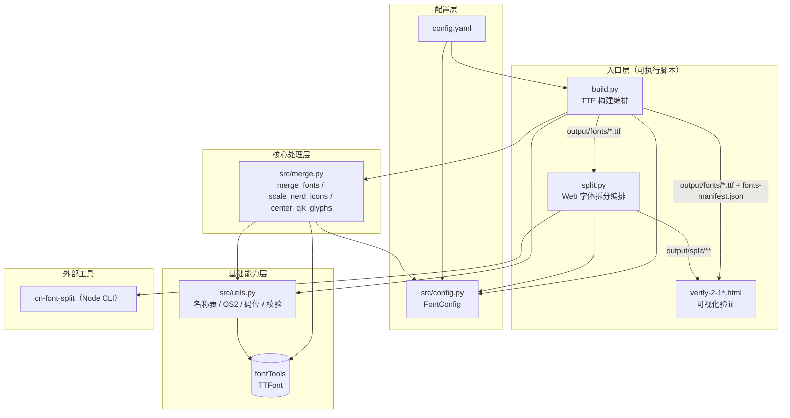
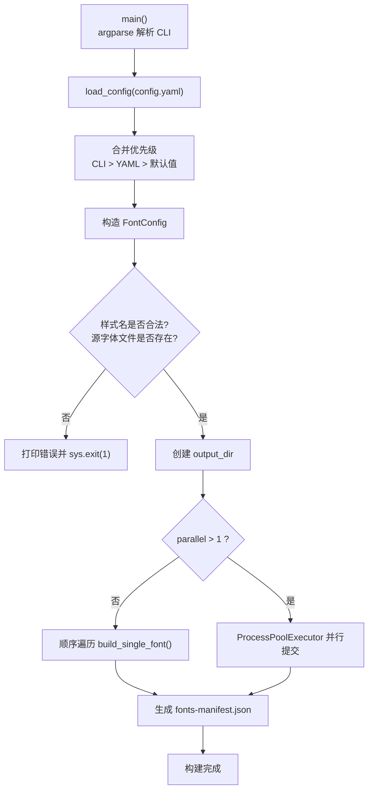
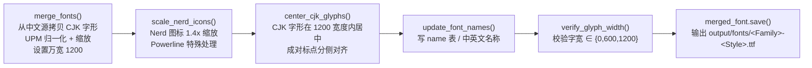
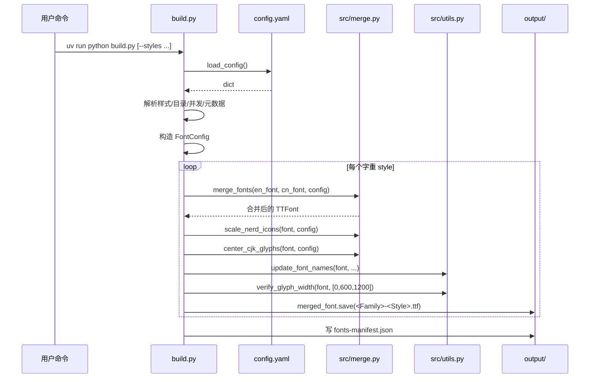
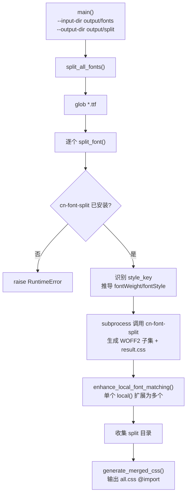
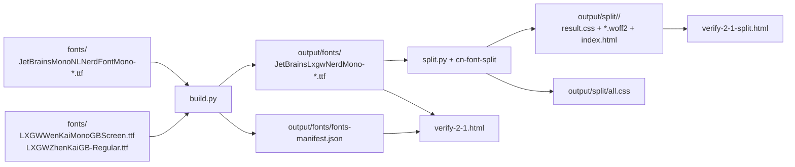

# 02 · 整体架构

## 2.1 分层视图

项目按「入口层 → 编排层 → 核心处理层 → 基础能力层」四层组织，职责单向依赖、无循环。



**依赖方向**：入口层依赖核心/基础层；核心层依赖配置与基础层；基础层只依赖第三方库 `fontTools`。`split.py` 不复用合并逻辑，仅复用 `FontConfig` 与外部 CLI。

## 2.2 目录与模块对应关系

| 分层 | 文件 | 说明 |
| --- | --- | --- |
| 入口层 | `build.py` | 解析参数与配置、循环/并行构建每个字重、写 manifest |
| 入口层 | `split.py` | 扫描 TTF、调用 `cn-font-split`、增强 CSS、生成 `all.css` |
| 配置层 | `config.yaml` | 外部配置（可被 CLI 覆盖） |
| 配置层 | `src/config.py` | 运行期强类型配置对象 `FontConfig` |
| 核心层 | `src/merge.py` | 字形级合并与几何调整 |
| 基础层 | `src/utils.py` | 字体表元数据写回与校验 |

## 2.3 构建主流程（build.py）

每个字重的构建是**一条固定顺序的加工链**，顺序不可随意调换（合并 → 图标缩放 → CJK 居中 → 改名 → 校验 → 保存）。



### 单个字重的加工链（`build_single_font`）



### 时序图：一次完整 build



### 时序图：三个后处理函数内部调用

下图展开 `scale_nerd_icons`、`center_cjk_glyphs`、`update_font_names` 三个函数的**内部细节**（它们在 `build_single_font` 中被依次调用）。`merge_fonts` 的深度调用链见 [04 · 关键类与函数 API 的图 C](./04-api-reference.md#图-c--merge_fonts-内部深度调用链)。

```mermaid
sequenceDiagram
    participant B as build.py<br/>build_single_font
    participant SN as merge.py<br/>scale_nerd_icons
    participant CC as merge.py<br/>center_cjk_glyphs
    participant UN as utils.py<br/>update_font_names
    participant SFN as utils.py<br/>set_font_name
    participant TTF as fontTools<br/>(glyf / hmtx / cmap / name)
    participant GCG as merge.py<br/>get_cjk_glyphs

    rect rgb(34, 197, 94)
        Note over B,TTF: ① scale_nerd_icons — Nerd Font PUA 图标处理
        B->>SN: scale_nerd_icons(merged_font, config)
        SN->>TTF: glyf=font["glyf"], hmtx=font["hmtx"],<br/>cmap=font["cmap"].getBestCmap()
        SN->>SN: nerd_glyph_map = {glyph_name: codepoint}<br/>筛选 U+E000–U+F8FF / U+F0000–U+FFFFD
        alt Powerline U+E0A0–U+E0DF
            loop 每个 Powerline 字形
                SN->>TTF: glyph.recalcBounds(glyf)
                SN->>TTF: 只水平坐标 translate((delta_x, 0))<br/>glyph.recalcBounds(glyf)
                SN->>TTF: hmtx[glyph] = (1200, ideal_lsb)
            end
        else 普通 PUA 图标
            loop 每个普通图标
                SN->>TTF: glyph.recalcBounds(glyf)
                SN->>TTF: glyph.coordinates.scale((1.4, 1.4))<br/>glyph.recalcBounds(glyf)
                SN->>TTF: coordinates.translate((delta_x, delta_y))<br/>水平居中 + 垂直对齐 y=360<br/>glyph.recalcBounds(glyf)
                SN->>TTF: hmtx[glyph] = (1200, ideal_lsb)
            end
        end
        SN-->>B: None（就地修改 font）
    end

    rect rgb(139, 92, 246)
        Note over B,TTF: ② center_cjk_glyphs — CJK 在 1200 宽内定位
        B->>CC: center_cjk_glyphs(merged_font, config)
        CC->>TTF: glyf=font["glyf"], hmtx=font["hmtx"],<br/>cmap=font["cmap"].getBestCmap()
        CC->>GCG: get_cjk_glyphs(font, config)
        GCG->>TTF: cmap.getBestCmap() → 遍历 is_cjk_codepoint
        GCG-->>CC: cjk_glyphs: Set[str]
        loop 每个 CJK 字形
            CC->>TTF: glyph.recalcBounds(glyf)
            alt 左标点【「（…
                CC->>TTF: coordinates.translate((1200-w-xMin, 0))
            else 右标点】」）…
                CC->>TTF: coordinates.translate((-xMin, 0))
            else 宽字形 w>600
                CC->>TTF: coordinates.translate(((1200-w)/2 - xMin, 0))
            else 窄字形 w≤600
                CC->>CC: 跳过
            end
            CC->>TTF: glyph.recalcBounds(glyf)
            CC->>TTF: hmtx[glyph] = (1200, ideal_lsb)
        end
        CC-->>B: None
    end

    rect rgb(249, 115, 22)
        Note over B,TTF: ③ update_font_names — 批量写 name 表
        B->>UN: update_font_names(font, family_name, style_name,<br/>full_name, postscript_name, version_str, ...)
        UN->>UN: unique_id = f"Version X;JBLXGW;{postscript}"

        loop 英文 (lang_id=0x409, mac=True)
            UN->>SFN: set_font_name(font, value, name_id)
            SFN->>TTF: font["name"].removeNames(nameID=name_id)
            SFN->>TTF: name.setName(value, platformID=3, platEncID=1, langID=0x409)
            SFN->>TTF: name.setName(value, platformID=1, platEncID=0, langID=0)
        end

        loop zh-CN (lang_id=0x804, mac=False)
            UN->>SFN: set_font_name(font, value, name_id,<br/>mac=False, lang_id=0x804)
            SFN->>TTF: font["name"].setName(value, platformID=3, platEncID=1, langID=0x804)
        end
        UN-->>B: None
    end

    style SN fill:#22c55e,color:#111
    style CC fill:#8b5cf6,color:#fff
    style UN fill:#f59e0b,color:#111
    style TTF fill:#3b82f6,color:#fff
```

## 2.4 Web 字体拆分流程（split.py）



### 样式识别与 CSS 属性推导

`split.py` 通过「文件名包含关键字」判定样式，并用**长关键字优先**的固定顺序匹配（避免 `Medium` 抢先匹配到 `MediumItalic`）：

| 匹配到的 `style_key` | `fontWeight` | `fontStyle` |
| --- | --- | --- |
| `Regular` | `400` | `normal` |
| `Medium` | `500` | `normal` |
| `Italic` | `400` | `italic` |
| `MediumItalic` | `500` | `italic` |
| `Bold` | `700` | `normal` |
| `BoldItalic` | `700` | `italic` |

## 2.5 数据流与产物



- **`fonts-manifest.json`**：`{ family_name, version, fonts:[{style, display_name, filename}] }`，是验证页动态生成 `@font-face` 的数据源。
- **`output/split/`**：每个字重一个子目录，含子集 `*.woff2`、`result.css`、`index.html`（拆分报告/预览），顶层 `all.css` 汇总所有字重。

## 2.6 关键设计决策

| 决策 | 原因 |
| --- | --- |
| 以英文字体为基底、只「注入」CJK 字形 | JetBrains Mono 已含完整 ASCII 与 Nerd 图标，改动面最小 |
| 统一 `unitsPerEm`（UPM）后再设 `cn_width` | 中文字体 UPM（如 2048）与英文字体（1000）不同，必须归一化才能保证比例 |
| 所有 `cmap` 子表都更新（不只 `getBestCmap`） | Office/Excel 可能只读 `format=4` 的 BMP 子表，缺失会导致中文不显示 |
| 合并 `OS/2` 的 Unicode/CodePage Range | Windows 应用据此判断「是否支持中文」，决定字体回退行为 |
| 名称表同时写 en-US(0x409) 与 zh-CN(0x804) | 提升 Windows/Excel 对中文字体的识别与显示 |
| 多进程而非多线程 | 字形合并是 CPU 密集且每个字重独立，`ProcessPoolExecutor` 可绕过 GIL |
| 校验字宽后仅告警不中断 | 源字体可能存在非常规字宽，`build.py` 捕获异常打印 Warning 后继续保存 |

## 2.7 相关文档

- 各模块的详细职责 → [03 · 模块职责](./03-modules.md)
- 函数级签名与行为 → [04 · 关键类与函数 API](./04-api-reference.md)
