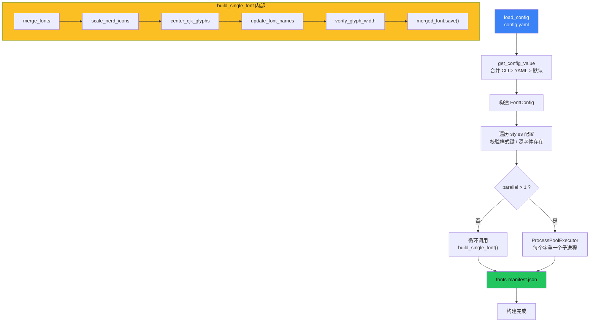
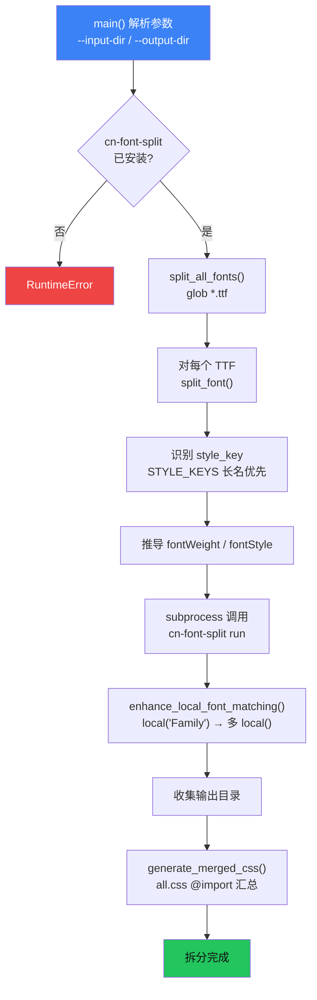
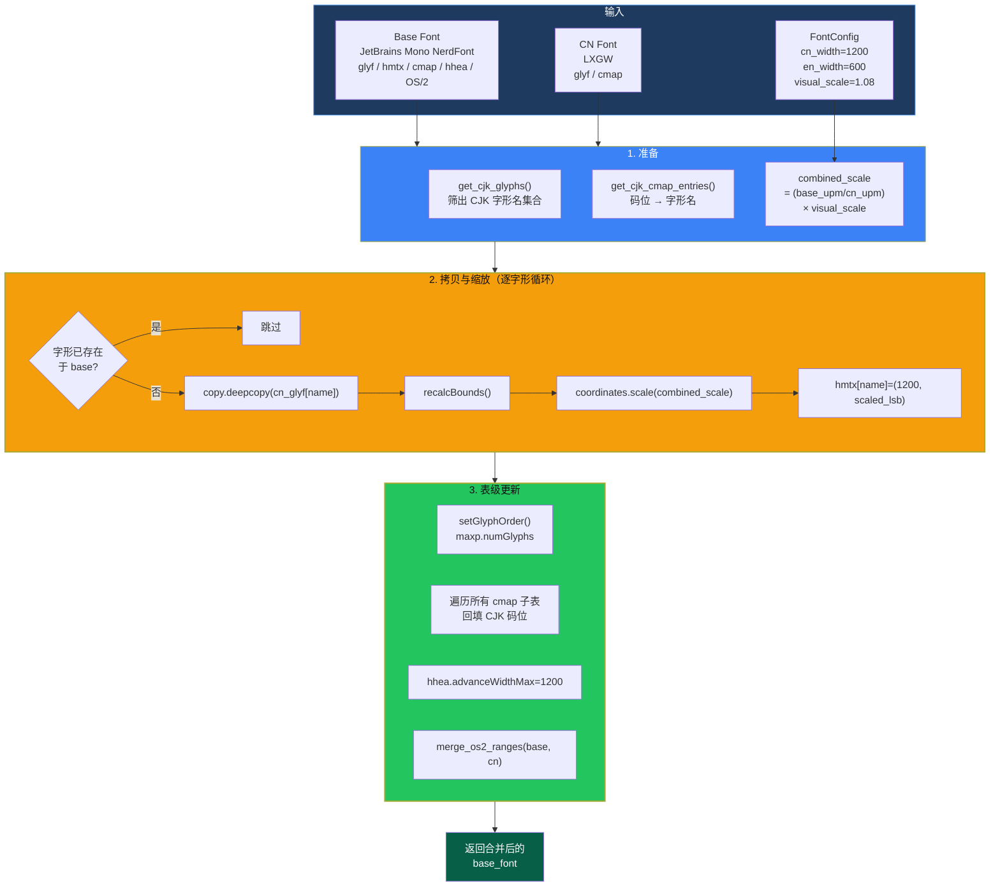
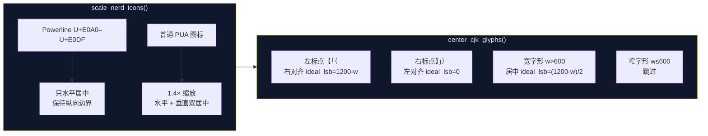
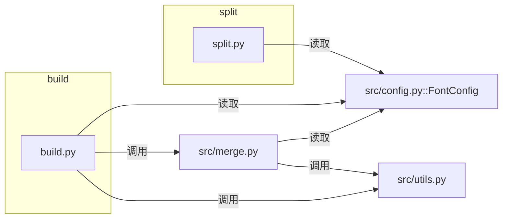

# 03 · 模块职责

本页从「文件/模块」粒度说明各部分的职责、边界与协作方式。函数级细节见 [04 · 关键类与函数 API](./04-api-reference.md)。

## 3.1 模块总览

| 模块 | 类型 | 职责 | 对外依赖 |
| --- | --- | --- | --- |
| `build.py` | 可执行脚本 | 构建编排：配置读取与优先级合并、字重校验、并行调度、manifest 生成 | `src.config`、`src.merge`、`src.utils`、`yaml` |
| `split.py` | 可执行脚本 | Web 字体编排：扫描 TTF、调用 `cn-font-split`、增强 `local()`、生成 `all.css` | `src.config`、`subprocess`、`shutil` |
| `src/config.py` | 配置模块 | 定义 `FontConfig` 数据类（宽度、缩放比、CJK 码位范围） | 无 |
| `src/merge.py` | 核心模块 | 字形级合并与几何处理（CJK 拷贝、Nerd 图标缩放、CJK 居中） | `src.config`、`src.utils`、`fontTools` |
| `src/utils.py` | 基础模块 | 字体元数据（name/OS2）写回、码位判断、字宽校验 | `fontTools` |
| `config.yaml` | 配置数据 | 字体元数据、源字重映射、构建选项、宽度比例 | — |
| `verify-2-1*.html` | 前端页面 | 读取 manifest / 拆分产物，可视化验证 2:1 对齐 | 构建产物 |
| `Dockerfile` | 构建定义 | 容器化 Python + uv 构建环境 | — |

## 3.2 `build.py` — 构建编排层

**职责边界**：只做「流程编排与 I/O」，不直接操作字形坐标；字形级工作全部下沉到 `src/merge.py`、`src/utils.py`。

内部结构：

| 函数 | 角色 |
| --- | --- |
| `load_config(config_path)` | 读取并解析 YAML；文件不存在时返回 `{}`（走默认值） |
| `get_config_value(yaml_config, *keys, default)` | 安全读取嵌套配置，任一层缺失即返回 `default` |
| `build_single_font(style, en_font_path, cn_font_path, display_name, output_dir, config, metadata)` | **单字重构建单元**，串联合并→图标→居中→改名→校验→保存 |
| `main()` | CLI 解析、配置合并、校验、顺序/并行调度、写 manifest |

**关键行为**

1. **配置优先级**：`CLI 参数 > config.yaml > 代码默认值`。
2. **前置校验**：样式名必须在 `config.yaml` 的 `styles` 中；`en_font`/`cn_font` 必须同时存在且文件真实存在，否则 `sys.exit(1)`。
3. **并行**：`parallel <= 1` 顺序执行；否则用 `ProcessPoolExecutor` 提交每个字重，`as_completed` 收集结果，任一失败则抛出。
4. **manifest**：构建结束后写 `output/fonts/fonts-manifest.json`，供验证页使用。

**内部流程**

## 3.3 `split.py` — Web 字体编排层

**职责边界**：不修改字形，只调用外部 Node 工具做子集拆分，并对生成的 CSS 做文本级增强。

内部结构：

| 函数 | 角色 |
| --- | --- |
| `check_cn_font_split_installed()` | 通过 `shutil.which("cn-font-split")` 判断外部 CLI 是否可用 |
| `enhance_local_font_matching(css_path, family_name, style_key)` | 把 `local("Family")` 扩展为 `local("PS名"),local("Full名"),local("Family")` |
| `split_font(font_path, output_base_dir, config, test_html=True)` | 单字体拆分：识别样式→推导 CSS 属性→调用 CLI→增强 CSS |
| `generate_merged_css(split_dirs, output_file)` | 为每个子目录生成 `@import`，汇总为 `all.css` |
| `split_all_fonts(input_dir, output_dir, config)` | 扫描 `*.ttf` 并逐个拆分，容错后统一生成 CSS |
| `main()` | argparse（`--input-dir` / `--output-dir`）与日志配置 |

**关键行为**

- 样式识别使用 `STYLE_KEYS = ["MediumItalic", "BoldItalic", "Medium", "Italic", "Bold", "Regular"]`（长名优先）。
- 由样式推导 `--css.fontWeight` / `--css.fontStyle`，并固定 `--css.fontDisplay swap`、`--renameOutputFont [index].[ext]`。
- 单个字重拆分失败仅记录错误，不中断其余字重。

**内部流程**

## 3.4 `src/config.py` — 运行期配置对象

**职责**：提供一个强类型的、带默认值的配置载体，贯穿 `build.py` → `merge.py`。

`FontConfig` 字段分组：

| 分组 | 字段 | 默认值 | 含义 |
| --- | --- | --- | --- |
| 命名 | `family_name` / `family_name_compact` | `"JetBrainsLxgwNerdMono"` | 字体族名（当前二者相同） |
| 命名 | `version` | `"1.0"` | 版本号字符串 |
| 缩放 | `visual_scale` | `1.08` | CJK 视觉放大系数（1.0 = 不额外放大） |
| 宽度 | `en_width` | `600` | 英文/图标目标宽度 |
| 宽度 | `cn_width` | `1200` | CJK 目标宽度（=2×英文） |
| Unicode | `cjk_ranges` | 见下方说明 | 参与合并的 CJK 码位区间 |

`cjk_ranges` 覆盖：CJK 统一表意文字主体/A~G 扩展、CJK 符号标点、全角/半角形式、康熙部首、注音符号、CJK 笔画、带圈 CJK、兼容区等。完整列表见 [06 · 配置说明](./06-configuration.md#67-cjk-码位范围cjk_ranges)。

> 注意：`config.yaml` 中的 `font`/`width` 字段在 `build.py` 中被读取并**显式传入** `FontConfig`；`cjk_ranges` 目前不在 YAML 中暴露，仅使用代码默认值。

## 3.5 `src/merge.py` — 核心合并模块

**职责**：所有「动字形」的逻辑集中于此，是本项目最核心、最需要小心处理的模块。

| 函数 | 职责 |
| --- | --- |
| `get_cjk_glyphs(font, config)` | 从字体 `cmap` 中筛出落在 CJK 区间的**字形名集合** |
| `get_cjk_cmap_entries(font, config)` | 返回 `码位 → 字形名` 映射（仅 CJK） |
| `merge_fonts(base_font_path, cn_font_path, config)` | **主合并**：深拷贝 CJK 字形到基底、缩放、设宽、更新 glyph order/cmap/hhea/OS2 |
| `scale_nerd_icons(font, config)` | 把 PUA 图标缩放至 CJK 宽度并居中；Powerline 符号特判 |
| `center_cjk_glyphs(font, config)` | 在 1200 宽度内居中 CJK；成对标点按左右侧对齐；窄字形跳过 |

**易错点（源码中显式标注）**

1. 拷贝字形必须用 `cn_glyf[glyph_name]` 而非 `cn_glyf.glyphs[glyph_name]`——后者返回未反编译、无 `coordinates` 的对象。
2. 缩放前需确保 `xMin` 已计算（必要时 `recalcBounds`），否则包围盒为空导致定位错误。
3. `cmap` 更新必须遍历**所有** Unicode 子表（platform 3 enc 1/10 与 platform 0），而非仅 `getBestCmap()`；`format=4` 表只能容纳 BMP（≤ U+FFFF）。
4. 深拷贝 `copy.deepcopy` 避免污染源字体对象。

**`merge_fonts` 核心内部逻辑**

**后处理函数的几何操作**

## 3.6 `src/utils.py` — 基础能力模块

**职责**：字体元数据写回与通用工具，**不改变字形几何**（除 `merge_os2_ranges` 修改 OS/2 位域）。

| 函数 | 职责 |
| --- | --- |
| `set_font_name(font, name, name_id, mac=True, lang_id=0x409)` | 写单条 `name` 记录；Windows(3,1) + 可选 Mac(1,0)；英文时先清除旧值 |
| `update_font_names(font, family_name, style_name, full_name, postscript_name, version_str, ...)` | 批量写 NameID 0/1/2/3/4/5/6/7/8/9/10/11/12/13/14/16/17，并追加 zh-CN(0x804) 名称 |
| `merge_os2_ranges(target_font, source_font)` | 按位或合并 `ulUnicodeRange1-4` 与 `ulCodePageRange1-2` |
| `is_cjk_codepoint(codepoint, cjk_ranges)` | 判断码位是否落在任一 CJK 区间 |
| `verify_glyph_width(font, expected_widths, file_name)` | 校验所有字形 advance width ∈ 期望集合（0 例外），异常抛 `ValueError` |

**设计意图**：把「字体元数据正确性」这类跨平台兼容细节（Excel 中文识别、Mac 名称匹配、Windows 字体回退）封装在独立模块，供 `build.py` 一处调用。

## 3.7 `config.yaml` / `pyproject.toml` / `Dockerfile`

- **`config.yaml`**：唯一外部配置源，字段详解见 [06 · 配置说明](./06-configuration.md)。
- **`pyproject.toml`**：声明 `fonttools>=4.47.0`、`pyyaml>=6.0`，要求 Python `>=3.10`，使用 `hatchling` 打包 `src` 包。
- **`Dockerfile`**：`python:3.11-slim` → 安装 `uv` → 复制 `pyproject.toml`/`src/`/`build.py` → `uv sync --no-dev` → 挂载 `/app/fonts`、`/app/output`，默认执行 `build.py`。

## 3.8 验证页（前端模块）

`verify-2-1.html` 的脚本逻辑：

1. `fetch('output/fonts/fonts-manifest.json')` 读取字重清单；
2. `injectFontFaces()` 动态生成 `@font-face`（`font-family: '<Family>-<Style>'`，`src: url(...ttf)`）；
3. `populateSelect()` 填充字重下拉框；
4. 切换字重时 `applyFont()` 修改示例文本的 `font-family`；
5. manifest 读取失败时进入 `fallbackMode()`，用内置 4 个字重兜底。

`verify-2-1-split.html` 面向拆分产物：通过 `<link>` 加载 `output/split/all.css`（而非逐个注入 TTF 的 `@font-face`），同样用 manifest 填充字重下拉，内置 `WEIGHT_MAP` 将样式映射到 `font-weight`/`font-style`。

> 由于浏览器 CORS 限制，直接以 `file://` 打开可能无法 `fetch` manifest，需用本地 HTTP 服务（见 [07 · 构建与运行](./07-build-and-run.md)）。

## 3.9 模块协作关系

| 调用方 → 被调方 | 具体接口 |
| --- | --- |
| `build.py` → `src.merge` | `merge_fonts`、`center_cjk_glyphs`、`scale_nerd_icons` |
| `build.py` → `src.utils` | `update_font_names`、`verify_glyph_width` |
| `src.merge` → `src.utils` | `is_cjk_codepoint`、`merge_os2_ranges` |
| `src.merge` → `src.config` | `FontConfig`（`cn_width`/`en_width`/`visual_scale`/`cjk_ranges`） |
| `split.py` → `src.config` | `FontConfig`（仅 `family_name`） |

## 3.10 相关文档

- 函数签名与参数逐项说明 → [04 · 关键类与函数 API](./04-api-reference.md)
- 配置字段 → [06 · 配置说明](./06-configuration.md)
