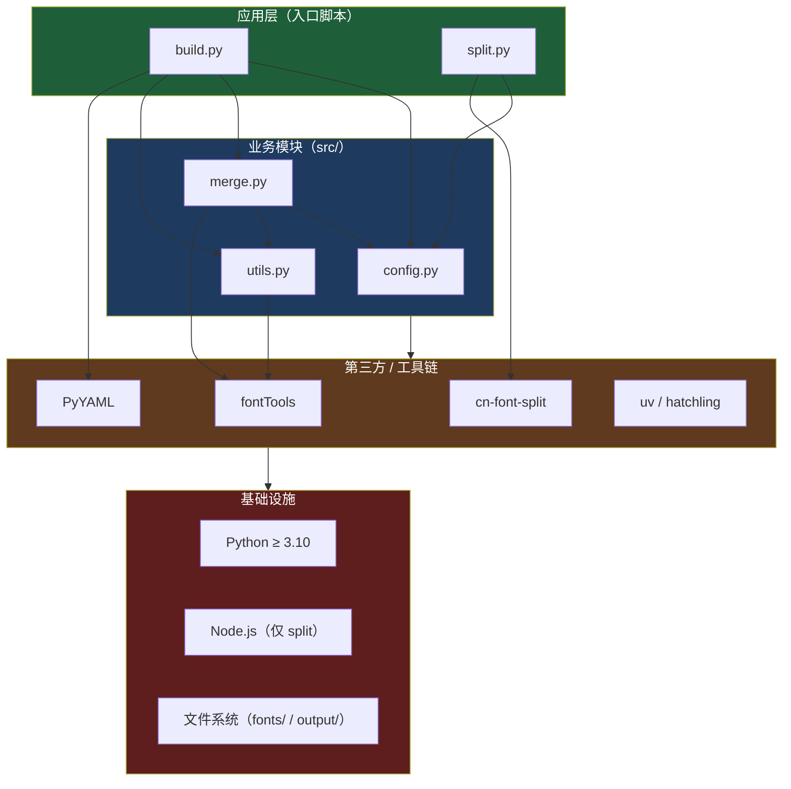
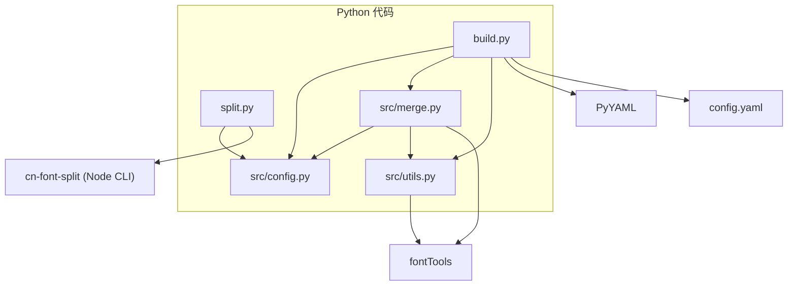
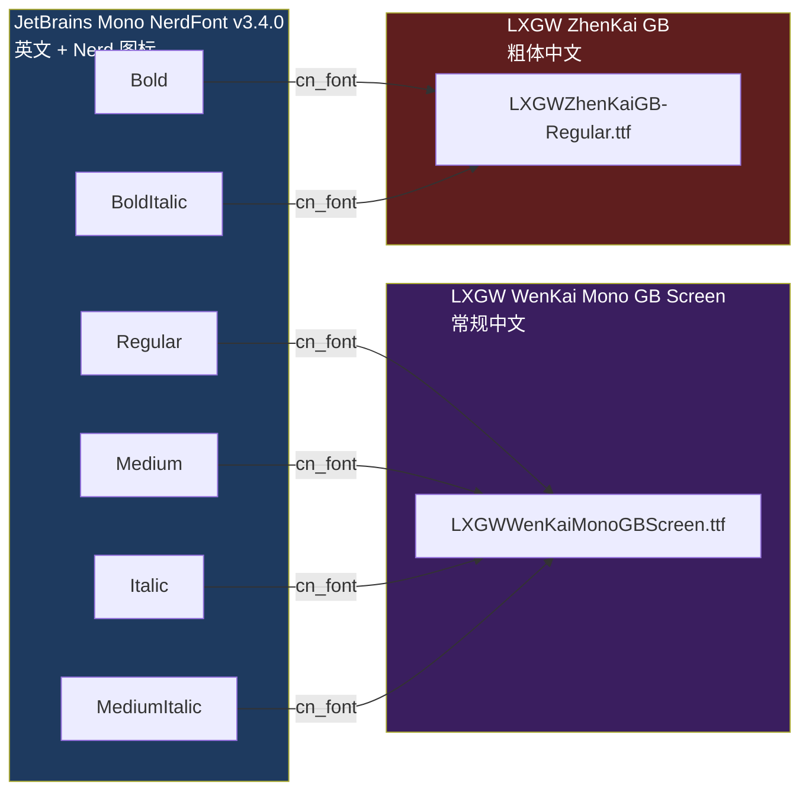

# 05 · 依赖关系

## 5.1 运行时依赖（Python）

来自 `pyproject.toml`：

| 依赖 | 版本约束 | 用途 | 使用位置 |
| --- | --- | --- | --- |
| `fonttools` | `>=4.47.0` | 读写/操作 TTF 表（`TTFont`、`glyf`、`cmap`、`hmtx`、`name`、`OS/2`） | `src/merge.py`、`src/utils.py` |
| `pyyaml` | `>=6.0` | 解析 `config.yaml` | `build.py` |

`requires-python = ">=3.10"`（代码使用了 `str | None` 类型语法）。

## 5.2 标准库依赖（非第三方）

| 模块 | 使用位置 | 用途 |
| --- | --- | --- |
| `argparse` | `build.py`、`split.py` | 命令行参数 |
| `concurrent.futures`（`ProcessPoolExecutor`, `as_completed`） | `build.py` | 多进程并行构建字重 |
| `json` | `build.py` | 生成 `fonts-manifest.json` |
| `pathlib.Path` | 全部脚本 | 路径操作 |
| `sys` | `build.py`、`split.py` | `sys.path` 注入、`sys.exit` |
| `copy` | `src/merge.py` | 深拷贝字形对象 |
| `re` | `split.py` | 正则替换 `local()` |
| `shutil` | `split.py` | `which()` 检测外部 CLI |
| `subprocess` | `split.py` | 调用 `cn-font-split` |
| `logging` | `split.py` | 运行日志 |
| `dataclasses` | `src/config.py` | `@dataclass` |
| `typing` | 全部 | 类型标注 |

## 5.3 构建期 / 工具链依赖

| 工具 | 版本/来源 | 用途 |
| --- | --- | --- |
| `uv` | Docker 中 `pip install uv`；本地推荐安装 | 依赖安装（`uv sync`）与脚本运行（`uv run`） |
| `hatchling` | `pyproject.toml` `[build-system]` | wheel 打包后端（`packages = ["src"]`） |
| `cn-font-split` | **外部 Node CLI**，需 `npm install -g cn-font-split` | TTF → WOFF2 子集拆分、生成 CSS/报告 |
| Docker | 可选 | 容器化构建（`python:3.11-slim`） |

> `cn-font-split` 是**可选但 Web 拆分必需**的外部依赖：`build.py` 不依赖它；只有运行 `split.py` 时才需要，缺失会抛 `RuntimeError`。

### 依赖层次图

## 5.4 模块间依赖图

**依赖特点**

- **无循环依赖**：`utils` 不反向依赖 `merge`/`build`。
- **`config` 是纯数据**：被 `build`/`merge`/`split` 读取，本身不依赖任何项目模块。
- **`split` 与合并逻辑解耦**：仅共享 `FontConfig`，不导入 `merge`/`utils`。

## 5.5 输入依赖：源字体

| 源字体 | 版本（README 标注） | 角色 | 需要放入的项目路径 |
| --- | --- | --- | --- |
| JetBrainsMonoNLNerdFontMono-Regular/Medium/Italic/MediumItalic/Bold/BoldItalic | v3.4.0 | 英文 + Nerd 图标基底 | `fonts/` |
| LXGWWenKaiMonoGBScreen.ttf | v1.521 | CJK（Regular/Medium 及其斜体） | `fonts/` |
| LXGWZhenKaiGB-Regular.ttf | — | CJK（Bold/BoldItalic，笔画更重） | `fonts/` |

仓库的 `fonts/` 目录当前已包含上述文件；缺失时 `build.py` 会在校验阶段报错退出。

### 源字体到字重的映射关系（当前仓库）

## 5.6 依赖与产物的关系

| 依赖 | 影响产物 |
| --- | --- |
| `fontTools` | 决定 TTF 生成与所有字形/表操作的可行性 |
| `PyYAML` + `config.yaml` | 决定字重映射、元数据、宽度、并发 |
| `cn-font-split` | 决定 `output/split/` 的 WOFF2 子集与 CSS 是否存在 |
| `uv.lock` | 锁定 Python 依赖版本，保证构建可复现 |

## 5.7 相关文档

- 各依赖如何被调用 → [04 · 关键类与函数 API](./04-api-reference.md)
- 环境准备与命令 → [07 · 构建与运行](./07-build-and-run.md)
