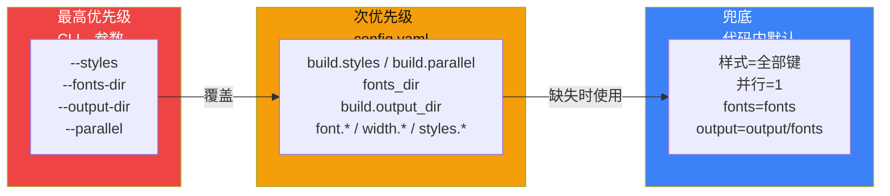
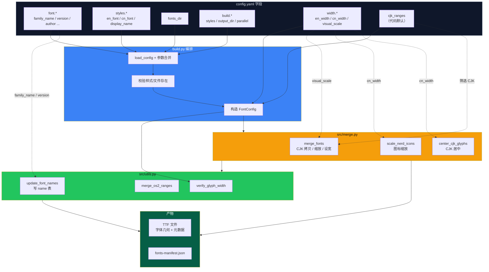

# 06 · 配置说明

`config.yaml` 是构建流程的**唯一外部配置源**。本页逐字段说明其含义、默认值与在代码中的消费位置。

## 6.1 优先级规则



```text
命令行参数（CLI）  >  config.yaml  >  代码内默认值
```

`build.py` 中通过 `args.X or/if ... get_config_value(yaml, ...)` 实现。各字段的取值来源如下：

| 配置项 | CLI 参数 | YAML 路径 | 代码默认 | 消费处 |
| --- | --- | --- | --- | --- |
| 构建样式 | `--styles` | `build.styles` | `styles` 的全部键 | `main()` |
| 源字体目录 | `--fonts-dir` | `fonts_dir` | `fonts` | `main()` |
| 输出目录 | `--output-dir` | `build.output_dir` | `output/fonts` | `main()` |
| 并行度 | `--parallel` | `build.parallel` | `1` | `main()` |
| 配置文件 | `--config` | — | `<repo>/config.yaml` | `main()` |

## 6.2 `font` 段 · 字体元数据

写入生成字体的 `name` 表，并用于拼接文件名/PostScript 名。

| 字段 | 默认 | 用途 | 写入位置 |
| --- | --- | --- | --- |
| `family_name` | `JetBrainsLxgwNerdMono` | 字体族名 | NameID 1/16、拆分 CSS `fontFamily` |
| `version` | `1.0` | 版本号 | NameID 5（`Version <v>`） |
| `author` | — | 作者 | NameID 8（Manufacturer）/ 9（Designer） |
| `copyright` | — | 版权 | NameID 0 |
| `description` | — | 描述 | NameID 10 |
| `url` | — | 项目地址 | NameID 11/12 |
| `license` | — | 许可证描述 | NameID 13 |
| `license_url` | — | 许可证链接 | NameID 14 |

> 当前仓库配置：`family_name = JetBrainsLxgwNerdMono`、`version = 1.3`、`author = lvbibir`。

## 6.3 `fonts_dir` · 源字体目录

| 字段 | 默认 | 说明 |
| --- | --- | --- |
| `fonts_dir` | `fonts` | 存放所有源 TTF 的目录；`styles.*` 中的文件名相对此目录解析 |

## 6.4 `styles` 段 · 字重 → 源字体映射

`styles` 是一个「样式键 → 源字体配置」的字典。**样式键**将出现在输出文件名与 PostScript 名中。

```yaml
styles:
  Regular:
    en_font: "JetBrainsMonoNLNerdFontMono-Regular.ttf"
    cn_font: "LXGWWenKaiMonoGBScreen.ttf"
    display_name: "Regular"
```

| 子字段 | 必填 | 说明 |
| --- | --- | --- |
| `en_font` | 是 | 英文/图标基底字体文件名（相对 `fonts_dir`） |
| `cn_font` | 是 | 中文来源字体文件名（相对 `fonts_dir`） |
| `display_name` | 否 | 展示名，写入 NameID 2/17 与 manifest（缺省回退为样式键） |

**校验规则**：`en_font` 与 `cn_font` 任一缺失、或文件不存在，`build.py` 都会打印错误并 `sys.exit(1)`。

### 当前仓库的字重映射

| 样式键 | 英文源 | 中文源 | display_name |
| --- | --- | --- | --- |
| `Regular` | `...NerdFontMono-Regular.ttf` | `LXGWWenKaiMonoGBScreen.ttf` | Regular |
| `Italic` | `...NerdFontMono-Italic.ttf` | `LXGWWenKaiMonoGBScreen.ttf` | Italic |
| `Medium` | `...NerdFontMono-Medium.ttf` | `LXGWWenKaiMonoGBScreen.ttf` | Medium |
| `MediumItalic` | `...NerdFontMono-MediumItalic.ttf` | `LXGWWenKaiMonoGBScreen.ttf` | Medium Italic |
| `Bold` | `...NerdFontMono-Bold.ttf` | `LXGWZhenKaiGB-Regular.ttf` | Bold |
| `BoldItalic` | `...NerdFontMono-BoldItalic.ttf` | `LXGWZhenKaiGB-Regular.ttf` | Bold Italic |

> **多字重中文字体**：如需为每个字重使用不同的中文文件，只需把对应样式的 `cn_font` 指向不同文件即可，无需改代码。

## 6.5 `build` 段 · 构建选项

| 字段 | 默认 | 说明 |
| --- | --- | --- |
| `styles` | 所有 `styles` 键 | 逗号分隔的待构建样式列表；仅支持已定义的键 |
| `output_dir` | `output/fonts` | TTF 与 `fonts-manifest.json` 输出目录 |
| `parallel` | `1` | 并行进程数；`<=1` 顺序执行，`>1` 使用 `ProcessPoolExecutor` |

> `parallel` 建议设为样式的数量（仓库默认 `6`），每个字重独立进程构建。

## 6.6 `width` 段 · 宽度与缩放

实现 2:1 等宽比的核心参数。

| 字段 | 默认 | 说明 |
| --- | --- | --- |
| `en_width` | `600` | 英文/图标的 advance width（FUnit） |
| `cn_width` | `1200` | CJK 的 advance width（FUnit）；**应为 `en_width` 的 2 倍** |
| `visual_scale` | `1.08` | CJK 字形视觉放大系数，叠加在 UPM 归一化之上 |

**计算关系**（见 `src/merge.py::merge_fonts`）：

```text
combined_scale = (base_upm / cn_upm) * visual_scale
CJK advance width = cn_width（固定）
```

`visual_scale` 仅改变字形轮廓大小，不改变 advance width，因此不影响 2:1 对齐，只影响「字的视觉饱满度」。

## 6.7 CJK 码位范围（`cjk_ranges`）

该字段**不在 `config.yaml` 中暴露**，由 `src/config.py::FontConfig.cjk_ranges` 的代码默认值提供。只有落在这些区间的码位才会从中文源字体拷入。

| 区间 | 名称 |
| --- | --- |
| `U+4E00–U+9FFF` | CJK 统一表意文字 |
| `U+3400–U+4DBF` | 扩展 A |
| `U+20000–U+2A6DF` | 扩展 B |
| `U+2A700–U+2B73F` | 扩展 C |
| `U+2B740–U+2B81F` | 扩展 D |
| `U+2B820–U+2CEAF` | 扩展 E |
| `U+2CEB0–U+2EBEF` | 扩展 F |
| `U+30000–U+3134F` | 扩展 G |
| `U+3000–U+303F` | CJK 符号和标点 |
| `U+FF00–U+FFEF` | 半角及全角形式 |
| `U+2E80–U+2EFF` | CJK 部首补充 |
| `U+2F00–U+2FDF` | 康熙部首 |
| `U+3100–U+312F` | 注音符号 |
| `U+31A0–U+31BF` | 注音符号扩展 |
| `U+31C0–U+31EF` | CJK 笔画 |
| `U+3200–U+32FF` | 带圈 CJK 字母及月份 |
| `U+3300–U+33FF` | CJK 兼容 |
| `U+FE30–U+FE4F` | CJK 兼容形式 |

> 若要扩展合并范围（如加入 Emoji 或其它符号），需修改 `src/config.py` 的默认值。

## 6.8 完整示例

```yaml
font:
  family_name: "JetBrainsLxgwNerdMono"
  version: "1.3"
  author: "lvbibir"
  copyright: "Copyright (c) 2024 lvbibir"
  description: "JetBrains Mono NerdFont + LXGW WenKai Mono merged font with 2:1 CJK ratio."
  url: "https://github.com/lvbibir/JetBrainsLxgwNerdMono"
  license: "SIL Open Font License, Version 1.1."
  license_url: "https://openfontlicense.org"

fonts_dir: "fonts"

styles:
  Regular:
    en_font: "JetBrainsMonoNLNerdFontMono-Regular.ttf"
    cn_font: "LXGWWenKaiMonoGBScreen.ttf"
    display_name: "Regular"
  # ... 其余字重

build:
  styles: "Regular,Medium,Italic,MediumItalic,Bold,BoldItalic"
  output_dir: "output/fonts"
  parallel: 6

width:
  en_width: 600
  cn_width: 1200
  visual_scale: 1.08
```

## 6.8 配置影响面总览

下图展示每个配置段影响的代码模块、处理阶段与最终产物。



## 6.9 相关文档

- 这些字段最终如何被使用 → [04 · 关键类与函数 API](./04-api-reference.md)
- 如何执行构建 → [07 · 构建与运行](./07-build-and-run.md)
