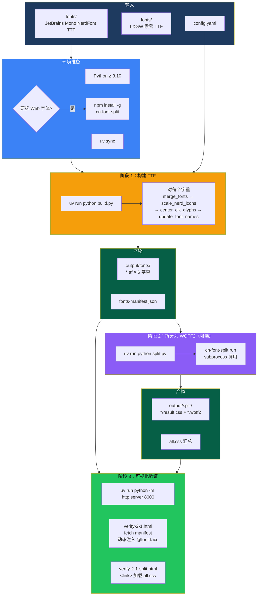
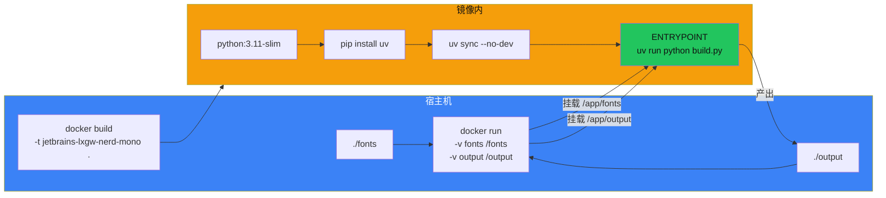
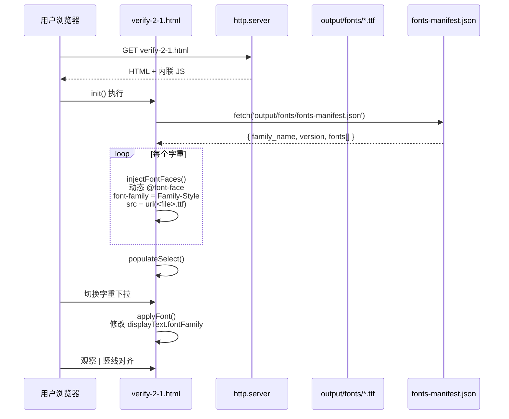

# 07 · 构建与运行

本页覆盖：环境准备 → 放置源字体 → 构建 TTF → 拆分 Web 字体 → 可视化验证 → 产物说明 → 常见问题。

## 0 · 端到端流水线总览



## 7.1 环境要求

| 依赖 | 版本 | 必需性 | 说明 |
| --- | --- | --- | --- |
| Python | `>=3.10` | 必需 | 运行 `build.py` / `split.py` |
| [uv](https://github.com/astral-sh/uv) | 最新 | 推荐 | 依赖安装与运行（也可用 pip + venv） |
| Node.js + `cn-font-split` | — | 仅 Web 拆分需要 | `npm install -g cn-font-split` |
| Docker | — | 可选 | 容器化构建 |

## 7.2 放置源字体

将下列文件放入 `fonts/`（文件名必须与 `config.yaml` 中的 `en_font`/`cn_font` 一致）：

**JetBrains Mono NerdFont v3.4.0**（英文 + 图标基底）

```text
JetBrainsMonoNLNerdFontMono-Regular.ttf
JetBrainsMonoNLNerdFontMono-Medium.ttf
JetBrainsMonoNLNerdFontMono-Italic.ttf
JetBrainsMonoNLNerdFontMono-MediumItalic.ttf
JetBrainsMonoNLNerdFontMono-Bold.ttf
JetBrainsMonoNLNerdFontMono-BoldItalic.ttf
```

**LXGW 霞鹜（CJK 来源）**

```text
LXGWWenKaiMonoGBScreen.ttf     # Regular / Medium / Italic / MediumItalic
LXGWZhenKaiGB-Regular.ttf      # Bold / BoldItalic
```

> 下载地址见 [README.md](../README.md#source-fonts)。若文件缺失，`build.py` 会在启动校验时报错并退出。

## 7.3 使用 uv 构建（推荐）

```bash
# 1) 安装依赖（读取 pyproject.toml + uv.lock）
uv sync

# 2) 构建全部字重（读取 config.yaml）
uv run python build.py

# 3) 只构建部分字重
uv run python build.py --styles Regular,Medium

# 4) 自定义目录与并发
uv run python build.py \
  --fonts-dir fonts \
  --output-dir output/fonts \
  --parallel 6
```

### 参数速查（`build.py`）

```text
usage: build.py [-h] [--config CONFIG] [--styles STYLES] [--fonts-dir FONTS_DIR]
                [--output-dir OUTPUT_DIR] [--parallel PARALLEL]

--config      配置文件路径（默认 config.yaml）
--styles      逗号分隔的样式（默认取 build.styles）
--fonts-dir   源字体目录（默认取 fonts_dir）
--output-dir  输出目录（默认 build.output_dir）
--parallel    并行进程数（默认 build.parallel）
```

优先级：`CLI 参数 > config.yaml > 默认值`。

## 7.4 使用 Docker 构建

```bash
# 构建镜像
docker build -t jetbrains-lxgw-nerd-mono .

# 运行（挂载源字体与输出目录）
docker run --rm \
  -v $(pwd)/fonts:/app/fonts \
  -v $(pwd)/output:/app/output \
  jetbrains-lxgw-nerd-mono

# 指定字重
docker run --rm \
  -v $(pwd)/fonts:/app/fonts \
  -v $(pwd)/output:/app/output \
  jetbrains-lxgw-nerd-mono --styles Regular,Medium
```

**镜像说明**

- 基础镜像 `python:3.11-slim`，安装 `uv` 后执行 `uv sync --no-dev`；
- 仅复制 `pyproject.toml`、`src/`、`build.py`（**不包含 `split.py`**，因此容器内只做 TTF 构建）；
- 挂载点：`/app/fonts`（输入）、`/app/output`（输出）；
- 默认入口：`build.py --fonts-dir /app/fonts --output-dir /app/output`，追加参数会透传给 `build.py`。

**Docker 构建流程**



## 7.5 拆分 Web 字体（WOFF2）

```bash
# 前置：安装外部 CLI（需要 Node.js）
npm install -g cn-font-split

# 拆分 output/fonts 下的所有 TTF → output/split
uv run python split.py

# 自定义目录
uv run python split.py --input-dir my_fonts --output-dir my_split_fonts
```

### 参数速查（`split.py`）

```text
usage: split.py [-h] [--input-dir INPUT_DIR] [--output-dir OUTPUT_DIR]

--input-dir   输入目录（默认 output/fonts）
--output-dir  输出目录（默认 output/split）
```

### 拆分做了什么

1. 扫描输入目录下所有 `*.ttf`；
2. 对每个字体调用 `cn-font-split run`，生成 WOFF2 子集、`result.css`、`index.html` 报告；
3. 依据文件名推导 `fontWeight`（Bold→700 / Medium→500 / 其它→400）与 `fontStyle`（含 Italic→italic）；
4. 增强 `result.css` 中的 `local()`，兼容多种已安装字体名；
5. 生成顶层 `all.css`，用 `@import` 汇总所有字重。

## 7.6 产物结构

构建 + 拆分后的完整输出：

```text
output/
├── fonts/                                  # TTF 构建产物
│   ├── JetBrainsLxgwNerdMono-Regular.ttf
│   ├── JetBrainsLxgwNerdMono-Medium.ttf
│   ├── JetBrainsLxgwNerdMono-Italic.ttf
│   ├── JetBrainsLxgwNerdMono-MediumItalic.ttf
│   ├── JetBrainsLxgwNerdMono-Bold.ttf
│   ├── JetBrainsLxgwNerdMono-BoldItalic.ttf
│   └── fonts-manifest.json                 # 验证页数据源
└── split/                                  # Web 字体产物
    ├── all.css                             # 汇总 @import
    └── JetBrainsLxgwNerdMono-Regular/
        ├── result.css                      # 单字重 @font-face
        ├── index.html                      # 拆分报告/预览
        └── *.woff2                         # 子集文件
```

> 顶层 `output/` 与 `*.ttf` 被 `.gitignore` 忽略，属构建产出的临时/发布文件。

## 7.7 可视化验证 2:1 等宽比

**TTF 版本**

```bash
uv run python -m http.server 8000
# 打开 http://localhost:8000/verify-2-1.html
```

**拆分后的 Web 字体版本**

```bash
uv run python -m http.server 8000
# 打开 http://localhost:8000/verify-2-1-split.html
```

验证方法：页面中每行末尾的 `|` 竖线应逐行严格对齐——这证明「1 个汉字 = 2 个英文字符宽」。页面顶部可切换字重。

> ⚠️ **必须通过 HTTP 访问**：验证页用 `fetch` 读取 `fonts-manifest.json`，`file://` 协议会因 CORS 失败。若确实直接打开，页面会进入 `fallbackMode()` 使用内置字重列表兜底（可能无法加载实际文件）。

**验证页的数据流（TTF 版）**



## 7.8 常见问题（FAQ）

| 现象 | 原因 | 处理 |
| --- | --- | --- |
| `Error: English font not found` / `Chinese font not found` | `fonts/` 缺少源文件或文件名不匹配 | 按 `config.yaml` 的 `en_font`/`cn_font` 放置 |
| `Error: Invalid style '...'` | `--styles` 含未定义样式 | 使用 `config.yaml` `styles` 中的键 |
| `cn-font-split is not installed` | 未安装 Node CLI | `npm install -g cn-font-split` |
| 验证页显示 “Error loading fonts” | 以 `file://` 打开、或未先构建 | 先 `build.py`，再用 `http.server` 访问 |
| `Warning: Found N glyphs with unexpected widths` | 源字体含非 600/1200 字宽 | 一般可忽略（不中断构建）；必要时排查源字体 |
| 中文缺字/显示为方块 | 目标字不在 `cjk_ranges` 内或中文源无该字 | 扩展 `cjk_ranges` 或更换中文源字体 |
| Excel/Windows 不显示中文 | OS/2 范围或中文名称缺失 | 本项目已通过 `merge_os2_ranges` + zh-CN 名称处理 |

## 7.9 从源码到产物的完整命令序列

```bash
# 1. 安装 Python 依赖
uv sync
# 2. 确保 fonts/ 下已有源字体
# 3. 构建 TTF 与 manifest
uv run python build.py
# 4. (可选) 安装并执行 Web 拆分
npm install -g cn-font-split
uv run python split.py
# 5. 本地预览/验证
uv run python -m http.server 8000
#    → http://localhost:8000/verify-2-1.html
#    → http://localhost:8000/verify-2-1-split.html
```

## 7.10 相关文档

- 构建内部原理 → [02 · 整体架构](./02-architecture.md)
- 配置逐项说明 → [06 · 配置说明](./06-configuration.md)
- 依赖清单 → [05 · 依赖关系](./05-dependencies.md)
